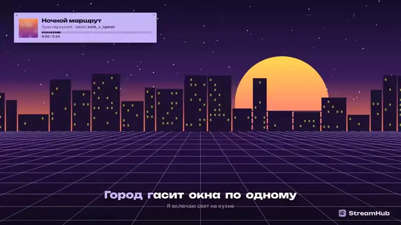
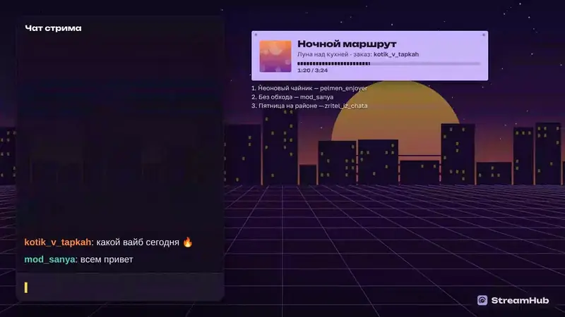
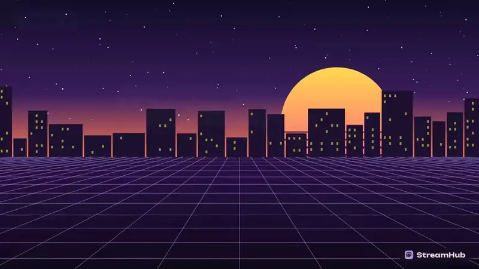
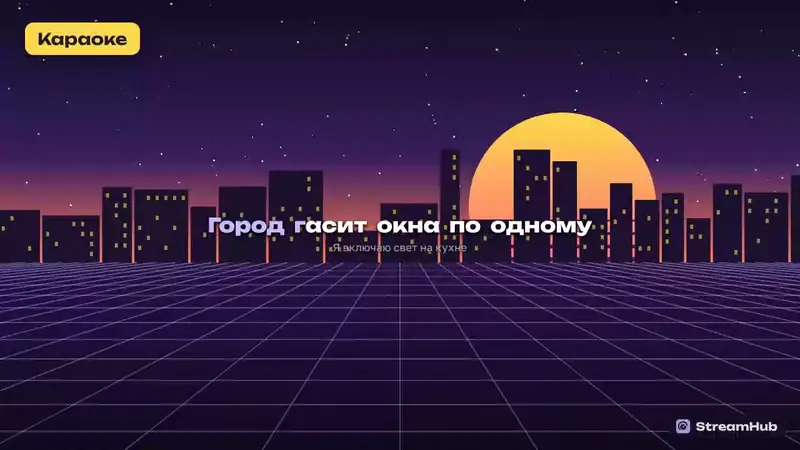
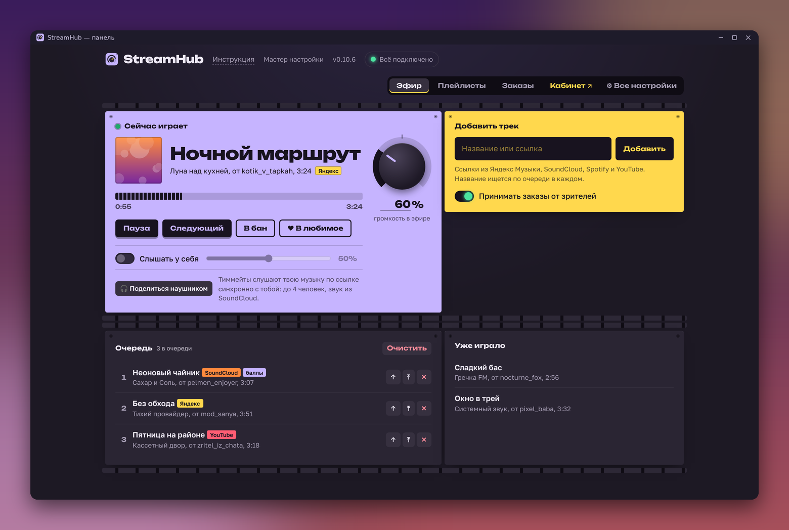
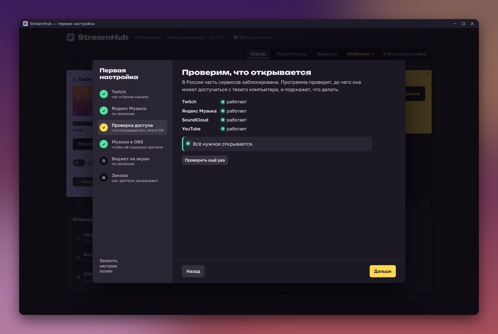

# 🎵 StreamHub

**Заказ музыки на стриме для Twitch и OBS.**
Яндекс Музыка и SoundCloud работают в России без обхода блокировок.

**[⬇ Скачать последнюю версию](https://github.com/queenofkuhnya/streamhub/releases/latest)** · [Инструкция](docs/guide.md) · [Команды чата](docs/guide.md#6-команды-в-чате)

## Почему StreamHub

- **Работает в России.** Яндекс Музыка и SoundCloud без VPN и zapret. Ссылки YouTube и Spotify тоже принимаются: если YouTube у тебя заблокирован, программа найдёт тот же трек в Яндексе или SoundCloud.
- **Ничего не надо устанавливать.** Распаковал, запустил `StreamHub.exe`, прошёл мастер настройки — готово. Обновления ставятся одной кнопкой.
- **Бесплатно и без подписок.** Никаких тарифов и лимитов на заказы.
- **Твоё остаётся у тебя.** Ни регистрации, ни аккаунтов у нас. Подробнее — [ниже](#-твоё-остаётся-у-тебя).

## Как это выглядит

**Зритель пишет `!sr` — трек в очереди, бот отвечает в чат**

**Шесть стилей виджета «Сейчас играет»** — или собери свой в конструкторе без кода

**Текст песни на экране**: караоке, полёт слов и кинетика

**Простая панель**: что играет, очередь, громкость — всё на одном экране

**Мастер первой настройки** сам проверит, какие сервисы открываются с твоего ПК

<b>Все возможности</b>

- Заказ ссылкой или по названию. Название ищется по очереди: Яндекс Музыка → SoundCloud → YouTube. Каждый источник включается отдельно.
- Ссылки **Spotify**: программа берёт из ссылки название, исполнителя и длительность (если Spotify недоступен — через song.link, который часто сразу знает этот трек в Яндекс Музыке) и находит тот же трек в Яндекс Музыке, SoundCloud или на YouTube.
- `!voteskip` — чат голосует за пропуск трека (порог фиксированный или процент от зрителей); `!позиция` — когда заиграет мой трек; `!кухня` — список всех команд в чат.
- **Конструктор плеера без кода**: фон (цвет, градиент, размытая обложка, своя картинка, прозрачный), свои картинки поверх плеера (PNG, JPG, GIF, WebP; двигаются мышкой в предпросмотре), своя картинка вместо обложки, цвета, шрифт, размеры, скругления, рамка, тень, что показывать, вид полоски прогресса, анимация появления; 8 пресетов, живой предпросмотр, размер для OBS считается сам, можно «превратить в код».
- **Свои виджеты на HTML/CSS/JS**: редактор с живым предпросмотром на вкладке «Оформление», метки `data-sh` для подстановки данных без программирования, шаблоны из всех встроенных стилей, экспорт и импорт одним файлом. Хранятся в папке настроек (`widgets`), страница виджета — `/w/<id>`.
- **Добавление в OBS одной кнопкой** через встроенный сервер WebSocket OBS (28+): плеер — сразу во все сцены с нужными галочками, виджеты и текст песни — в текущую сцену; свои виджеты обновляются в OBS после сохранения.
- Подробная инструкция для стримера — кнопка «Инструкция» в панели (страница guide.html).
- Заказ командой `!sr` в чате или за баллы канала. Если трек не подошёл, баллы возвращаются автоматически.
- Ограничения: треков на зрителя, максимальная длина, пауза между заказами, минимум просмотров, чёрные списки.
- **Что играет, когда никто не заказывает** (вкладка «Плейлисты»), один выбор из трёх: ничего, плейлист (по желанию с новыми похожими треками) или похожая музыка (автоподбор через «Похожие» Яндекса и related SoundCloud).
- **Плейлисты**: импорт по ссылке из Яндекс Музыки, SoundCloud, YouTube и Spotify, свои плейлисты из названий, кнопка «Обновить по ссылке».
- **`!лайк`** — трек попадает в плейлист «❤ Любимое чата», `!топ` — самые любимые, `!плейлист` — что играет между заказами (модеры: `!плейлист название` — сменить).
- В «Дополнительно»: свой плейлист для каждой сцены OBS, перемешивание, порог лайков.
- **Кабинет на kuhnya.xyz** (вход через Twitch): «Оформление» и «Настройки заказов» переехали туда; в панели программы «Заказы» видны всегда, «Оформление» — по кнопке «⚙ Все настройки». Работает, пока StreamHub запущен и включён kuhnyabot.
- **Диджейский пульт** `kuhnya.xyz/dj/<ник>`: стример выдаёт зрителям доступ в кабинете (срок и права). Пэды (синтезированные звуки), эквалайзер, фильтр, эхо, «стоп пластинки», две деки с кроссфейдером (свод следующего трека), очередь. Эффекты и свод — для Яндекса и SoundCloud.
- Музыка идёт отдельным аудиоисточником в OBS, поэтому её можно убрать из записи и VOD.
- Громкость крутилкой или точным числом, до 200% с защитой от хрипа, выравнивание громкости треков, отдельная громкость «для себя». Перемотка по шкале трека.
- Виджет «Сейчас играет» в шести стилях: Модуль, Минимал, Плеер-98, Кассета, Винил, Системная ошибка.
- **Текст песни на экране** в трёх режимах: караоке, полёт слов по экрану и кинетика. Текст берётся из Яндекс Музыки и с lrclib.net. Для slowed, speed up, nightcore и похожих версий он не показывается.
- Панель управления прямо в OBS.
- **Клавиши, которые работают в игре**: пауза, следующий трек, громкость, трек сначала. Можно включить медиаклавиши клавиатуры, а для Stream Deck и Touch Portal есть готовые ссылки.
- **Сообщения бота в чат**: все, тихо (только ответы и ошибки) или выключено.
- **Проверка доступа**: таблица, какие сервисы открываются с твоего ПК, и подсказки, если YouTube или Twitch заблокированы.

## Быстрый старт

1. [Скачай](https://github.com/queenofkuhnya/streamhub/releases/latest) `StreamHub-…-windows.zip`, распакуй и запусти `StreamHub.exe`.
   Windows может сказать «Windows защитила ваш компьютер» — нажми «Подробнее» → «Выполнить в любом случае»: у программы нет платной подписи.
2. Мастер настройки проведёт по шагам: Twitch → Яндекс Музыка → проверка доступа → плеер в OBS → виджет → заказы.
3. Готово: зрители пишут `!sr название или ссылка`.

Подробно про всё — в **[инструкции](docs/guide.md)**. Она же открывается кнопкой «Инструкция» в панели.

## 🔒 Твоё остаётся у тебя

StreamHub работает на твоём компьютере. У нас нет аккаунтов, регистрации и базы пользователей.

**Хранится только у тебя** (в `%LOCALAPPDATA%\StreamHub`):
- вход в Twitch и Яндекс Музыку — токены никуда не отправляются на хранение, Яндекс Плюс работает только на твоём ПК;
- очередь, плейлисты, настройки, оформление и свои виджеты;
- скачанные треки (сами удаляются через 12 часов).

**Что проходит через наш сервер kuhnya.xyz и зачем** — только то, без чего что-то не заработает:
- **kuhnyabot** сидит в твоём чате, пока включена программа, и пишет ответы. Видит то же, что любой зритель. Через 10 минут после выключения уходит. Можно выключить совсем — тогда отвечаешь ты сам.
- **Проверка, что это ты.** Программа показывает серверу твой Twitch-токен, сервер спрашивает у Twitch «чей это» и не записывает токен.
- **Кабинет и пульт диджея на сайте** передают команды твоей программе через сервер. Настройки сохраняются в программе, а не на сервере.
- **Название ролика YouTube и данные трека Spotify** — если у тебя они заблокированы. Отправляется только ссылка.
- **SoundCloud через сервер** — если провайдер обрывает загрузку. Сервер скачивает трек и отдаёт тебе. В служебном журнале сервера видно, какой канал запросил какой трек, — это нужно, чтобы чинить ошибки.
- **«Поделиться наушником»** — сервер помнит код ссылки, пока ты ей пользуешься. Ссылка без стримера удаляется через сутки.

**Напрямую с твоего ПК** программа ходит в Twitch, Яндекс Музыку, SoundCloud, YouTube, lrclib.net (тексты песен), song.link (ссылки Spotify) и GitHub (обновления).

Не нравится что-то из списка — почти всё выключается в настройках, и программа продолжит работать сама.

## Для разработчика

Сборка `StreamHub.exe` и выпуск обновлений — в [docs/BUILD.md](docs/BUILD.md).

## Благодарности

Работа с Яндекс Музыкой, SoundCloud и подбор текстов песен основаны на подходе мода MoonsCloud (форк Overtone от chifir4ik и PabJlo, лицензия MIT). Шрифты Unbounded и Golos — лицензия SIL OFL.

На картинках выдуманные треки, исполнители и зрители.
